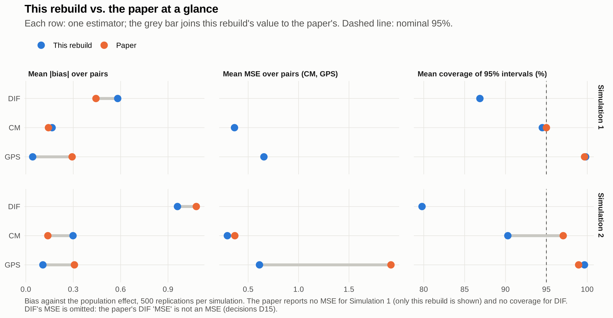
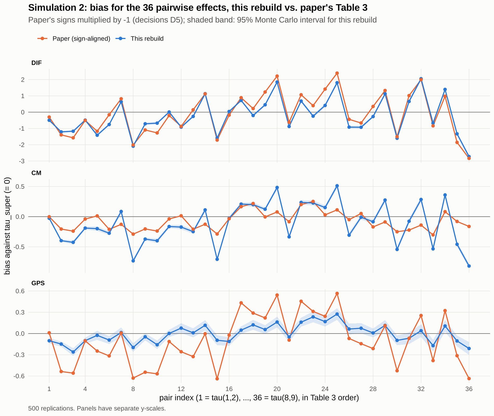
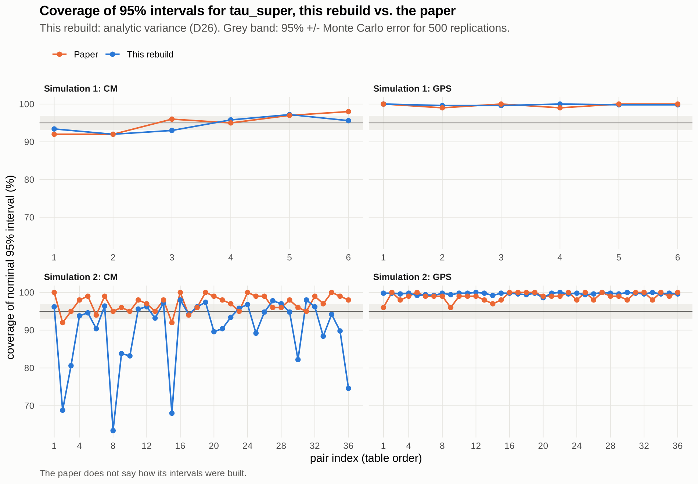

# Multilevel covariates matching and generalized propensity score matching: An R rebuild of Guo, Liu and Wang's (2022) simulations

Qiu Wang, Syracuse University · v1.0.0 · November 2026

## Key findings

Guo, Liu and Wang (2022) propose two estimators of average treatment effects
between combinations of treatments assigned at two levels: covariates matching
(CM) and generalized propensity score matching (GPS). They support both with two
simulation studies.

- **Main claims reproduced.** In an independent rebuild written from the paper's
  text alone, both matching estimators remove most of the bias of the sample
  difference (DIF), and CM has the smaller MSE. Both agree with the paper. CM's
  interval coverage in Simulation 1 is 94.5% (paper: 95%), and GPS's coverage
  is near 100%, as in the paper.
- **One ranking reversed.** In the paper CM is less biased than GPS (6/6 and
  32/36 pairs). In the rebuild GPS is less biased (CM less biased in 0/6 and
  6/36). For Simulation 2, mean |bias| is CM 0.30 vs the paper's 0.14, and GPS
  0.11 vs the paper's 0.31. The CM distance metric is not the cause.
- **Explanation not supported.** The paper attributes GPS's lower efficiency to
  a misspecified propensity model. A correctly specified model does not improve
  it, and matching on the population scores makes it worse. (The population
  scores are the propensity scores of the data-generating model: correct for
  the population, but not for a sample drawn with fixed group sizes.) The
  reason is the equal-group-size design: the population score does not balance
  the sample.
- **Two reporting questions.** The DIF "MSE" column of Table 3 (49–335) is close
  to the sum of the two within-group outcome variances, rather than to an MSE of
  a difference in means. The printed bias signs appear reversed relative to the
  paper's own definition.

The full verdict, claim by claim, is in
[`docs/replication_verdict.md`](docs/replication_verdict.md).

## Why this replication

School systems routinely compare educational programs that are assigned at more
than one level. During the COVID-19 return to school, for example, students chose
between hybrid and fully remote learning, while their schools differed in
location (rural, suburban, urban). That gives six treatment combinations at
once. Guo, Liu and Wang (2022) offer two matching estimators for
this setting, and their simulation studies are the main evidence for how well
the estimators perform. The paper released no code or data (its Code
Availability statement reads "N/A"), and several details needed to rerun the
simulations are unstated or inconsistent. Before the methods are applied to new
data or extended, it is worth checking that the reported results follow from
the published description.

I am one of the paper's authors. To keep the check independent of the original
program, the rebuild was written from the published text alone, without the
original code. Every point where the text had to be interpreted is recorded
with the options and the reason for the choice. The result is an open
implementation that others can run, inspect and extend.

## Background

With $l_X$ options at the individual level and $l_Z$ at the school level, each
unit receives one of $A = l_X l_Z$ treatment combinations, and the targets are
the pairwise effects $\tau(t,t') = E[Y(t) - Y(t')]$. Both estimators impute every
unit's potential outcome under every combination from its nearest neighbour in
that combination's group, then average over all units:

- **CM** matches on the covariates, using Mahalanobis distances on the
  individual-level covariates $X$ and on the school-level covariates $Z$.
- **GPS** matches on the estimated probability of receiving that combination,
  from a multinomial logit.

The paper also proposes balance diagnostics, which its simulation tables do not
use.

## Design (as in Section 5)

| | Simulation 1 | Simulation 2 |
|---|---|---|
| Treatment combinations | 4 (2 × 2) | 9 (3 × 3) |
| Pairwise effects | 6 | 36 |
| Covariates | $X_1..X_4$ correlated normal; $Z_1 \sim$ U(−3, 3) (D1), $Z_2 \sim \chi^2_1$, $Z_3 \sim$ Bernoulli(0.5) | same |
| Assignment | multinomial logit with quadratic terms | same, 9 categories |
| Outcomes | linear in the covariates, a different slope vector per combination, $N(0,1)$ error | same, 9 outcome models |
| Group size | 100 per combination | 200 per combination |
| Replications | 500 | 500 |
| Reported | \|bias\| and coverage (Table 1) | bias, MSE and coverage (Table 3) |

Full details are in [`docs/spec.md`](docs/spec.md). The paper's Tables 1 and 3
are transcribed in [`data/paper/`](data/paper) and were checked against the PDF
and for internal consistency.

## What differed

The paper leaves these points open or states them inconsistently. Each is
resolved in [`docs/decisions.md`](docs/decisions.md) (26 entries), where
possible using the paper's own DIF column, the one estimator with no modelling
choices:

- $Z_1 \sim$ "N[−3,3]" is read as Uniform(−3, 3). The centring in Simulation 2
  then makes every true effect zero (D1).
- The assignment probabilities as printed do not sum to one; we normalise them
  (D2).
- "100 [200] per treatment combination" is combined with model-based assignment
  by filling each group from the assignment model (D3). Bias is measured against
  the population effect (D4).
- The paper's signed biases match ours after a sign flip (D5).
- Not stated in the paper, and chosen here: the propensity model (main-effects
  multinomial logit, D12), the matching details (D9, D10), and the interval
  method (an analytic variance derived from the estimator's form, D26).
- $Y(1)$ in Simulation 2 lacks an error term, and Table 2's numbering repeats a
  label (D6, D7).

Sensitivity runs: GPS with a correctly specified logit and with the population
propensity scores, and CM under two other distance metrics.

## Results

Bias is $E(\hat\tau)-\tau$ against the population effect; the paper's signs are
flipped for comparison. Values are means over pairs, with 500 replications. The
largest Monte Carlo SE of a bias is 0.06.

| | Sim 1 \|bias\| ours / paper | Sim 1 MSE ours | Sim 2 \|bias\| ours / paper | Sim 2 MSE ours / paper |
|---|---|---|---|---|
| DIF | 0.58 / 0.44 | 1.78 | 0.96 / 1.08 | 2.30 / 182.9 (a different quantity; D15) |
| CM | 0.17 / 0.14 | 0.36 | 0.30 / 0.14 | 0.29 / 0.37 |
| GPS | 0.04 / 0.29 | 0.66 | 0.11 / 0.31 | 0.61 / 1.92 |
| GPS, correctly specified logit | 0.04 | 0.71 | 0.10 | 0.84 |
| GPS, population scores | 0.11 | 1.58 | 0.18 | 1.66 |



Coverage of 95% intervals, mean [min, max] over pairs:

| | Sim 1 ours | Sim 1 paper | Sim 2 ours | Sim 2 paper | estimated SE / true SD |
|---|---|---|---|---|---|
| CM | 94.5 [92.0, 97.2] | 95.0 [92, 98] | 90.3 [63.4, 98.0] | 97.1 [92, 100] | 1.05, 1.14 |
| GPS | 99.8 [99.6, 100] | 99.7 [99, 100] | 99.7 [98.6, 100] | 98.9 [96, 100] | 1.58, 1.51 |
| GPS, population scores | 94.4 | – | 94.2 | – | 0.98, 1.00 |
| DIF | 86.9 | – | 79.8 | – | 0.98, 1.01 |

- GPS covers almost 100% of the time because its intervals are too wide. Its
  standard error is calculated as if the propensity scores were known, and it
  is right when matching on the known population scores. Matching on estimated
  scores varies less (SD 0.76–0.79, against 1.23–1.25 with the population
  scores), so the standard error is about 1.5 times too large.
- CM under-covers in Simulation 2 where it is biased (per-pair coverage
  correlates −0.92 with |bias|/SD).

Simulation 2, bias of each of the 36 pairwise effects (the paper's Fig. 1 shows
its own values in the same order):



Coverage by pair:



All comparison figures, in [`figures/`](figures):

| Figure | Shows |
|---|---|
| [`summary_vs_paper.png`](figures/summary_vs_paper.png) | mean \|bias\|, MSE and coverage for DIF, CM and GPS, this rebuild vs. the paper, both simulations |
| [`sim1_absbias_vs_paper.png`](figures/sim1_absbias_vs_paper.png) | Simulation 1: \|bias\| for each of the 6 pairs, against Table 1 |
| [`sim2_bias_vs_paper.png`](figures/sim2_bias_vs_paper.png) | Simulation 2: signed bias for each of the 36 pairs, against Table 3 |
| [`sim2_mse_vs_paper.png`](figures/sim2_mse_vs_paper.png) | Simulation 2: MSE for each pair (log scale), including the within-group variance sum that the paper's DIF "MSE" tracks |
| [`bias_scatter_vs_paper.png`](figures/bias_scatter_vs_paper.png) | bias, this rebuild against the paper, one point per pair |
| [`sim2_bias_by_treatment_vs_paper.png`](figures/sim2_bias_by_treatment_vs_paper.png) | Simulation 2: each pair's bias split into one part per treatment (nine in all), showing which treatments drive the differences |
| [`estimator_overview.png`](figures/estimator_overview.png) | all five estimators, including the GPS sensitivity variants |
| [`cm_metric_sensitivity_sim2.png`](figures/cm_metric_sensitivity_sim2.png) | CM bias under three distance metrics, against the paper |
| [`coverage_vs_paper.png`](figures/coverage_vs_paper.png) | coverage of 95% intervals by pair, against Tables 1 and 3 |
| [`se_calibration.png`](figures/se_calibration.png) | estimated SE / true sampling SD, by estimator |

Reports: [`results/stage3_report.md`](results/stage3_report.md) (bias, MSE),
[`results/stage4_report.md`](results/stage4_report.md) (coverage),
[`results/cm_metric_sensitivity/report.md`](results/cm_metric_sensitivity/report.md).

## Reproduce

R 4.3.3 with `testthat` (and `nnet`, `MASS`, `ggplot2` for one test, the Stage-1
checks and the figures), e.g. from the Ubuntu 24.04 archive
(`r-base-core r-cran-testthat r-cran-nnet r-cran-mass r-cran-ggplot2`). The
estimators themselves use base R only. From the repository root:

```sh
Rscript scripts/run_tests.R                                         # 111 tests (~10 s)
Rscript scripts/compute_truth.R                                     # population truths (~2.5 min)
Rscript scripts/run_simulations.R sim1,sim2 1 500 results/runs 4    # 500 + 500 replications (~2.5 min)
Rscript scripts/stage3_analysis.R                                   # bias and MSE vs the paper, figures
Rscript scripts/run_extra.R cm_metrics sim1,sim2 1 500 results/runs_cm_metrics 4
Rscript scripts/cm_metric_analysis.R                                # CM metric sensitivity
Rscript scripts/run_extra.R stage4 sim1,sim2 1 500 results/runs_stage4 4
Rscript scripts/stage4_analysis.R                                   # coverage
Rscript scripts/comparison_figures.R                                # summary figures (from tracked tables only)
Rscript scripts/export_summary_long.R                               # tidy summary for comparisons (from tracked tables only)
```

The last argument is the number of cores. Each replication draws its random
numbers from its own separate, reproducible stream (R's L'Ecuyer-CMRG
generator; L'Ecuyer et al., 2002), so it gives the same result whether run
alone or in a batch. Runs
save one file per replication and resume if interrupted. Those per-replication
files (`results/runs*/`) are not tracked, but the combined estimates, intervals
and performance tables that the reports are built from are. The 20-replication
pilot and the Stage-1 checks of the paper's DIF column are `scripts/pilot_summary.R`
and `scripts/stage1_*.R`.

## Files

| Path | Contents |
|---|---|
| `R/` | the rebuild: DGP and group-filling sampler (`dgp.R`), multinomial logit by Newton–Raphson (`mlogit.R`), DIF, CM and GPS (`estimators.R`), variance estimators (`variance.R`), true effects (`truth.R`), random streams and resumable runner (`rng.R`, `run.R`), performance measures (`performance.R`) |
| `tests/testthat/` | 111 tests, including hand-worked matching and variance examples |
| `scripts/` | drivers for the tests, truths, runs, analyses and Stage-1 checks |
| `docs/` | `replication_verdict.md` (verdict), `spec.md` (specification), `decisions.md` (every interpretive choice), `comparison_interface.md` (definitions and file map for comparisons with other implementations) |
| `data/paper/` | the paper's Tables 1 and 3 as CSV |
| `results/sim1/`, `results/sim2/` | per-replication estimates, intervals (`.csv.gz`), performance against two truths, coverage, comparison with the paper |
| `results/truth/`, `results/stage1/`, `results/pilot/`, `results/cm_metric_sensitivity/` | population truths, Stage-1 evidence, pilot, CM metric sensitivity |
| `results/*.md`, `results/*.csv` | Stage 3 and Stage 4 reports, summary tables; `rebuild2_summary_long.csv` (all measures in one tidy table, see `docs/comparison_interface.md`) |
| `figures/` | comparisons with the paper's tables, coverage, SE calibration |

The work was done in four reviewed stages: specification, code and tests,
bias and MSE, and intervals and coverage.

## Lessons

- **Sampling each treatment group to a fixed size changes the propensity score
  within the sample.** The population score no longer balances the sample, so
  the score should be estimated from the sample itself. Here matching on the
  population scores was the worst GPS variant.
- **Check transcribed tables against their structure.** Every estimate here is
  the difference of two estimated means, one per treatment, so the bias for a
  pair is the error in one treatment's mean minus the error in the other's.
  Biases must therefore add up along a chain: bias(1,3) = bias(1,2) +
  bias(2,3). The paper's 108 signed biases in Table 3 pass this check to
  rounding, and Table 1's 18 absolute values pass it for one choice of signs,
  so a mistyped value would have shown up.
- **Tables should state their conventions.** One line in the table notes,
  giving the sign of the bias, what the MSE measures and the interval method,
  would have settled three of the paper's ambiguities.

## Conclusions

Guo, Liu and Wang's (2022) central simulation findings hold in an independent
rebuild. Matching on covariates or on a generalized propensity score removes
most of the confounding bias in comparisons of multilevel treatment
combinations, and covariates matching is the more efficient of the two. Two
findings do not hold:

- the tables' ranking of the two estimators by bias, which reverses here and
  depends on implementation details the paper does not report;
- the paper's explanation of GPS's lower efficiency, since correcting the
  propensity model does not help.

The DIF MSE column and the bias signs of Table 3 appear to follow different
conventions from the paper's own definitions.
An open implementation, with every interpretive choice recorded, is now
available as a basis for applying and extending the methods.

## Provenance

This rebuild (rebuild 2) was made from these inputs only:

- **The paper:** Guo, Liu & Wang (2022), as published. The PDF is not
  redistributed.
- **A written brief** from the author setting out the four stages, the
  practical limits, and the rules below.
- **Repository layout only:** after all four stages were complete, the public
  repository [wangqiu-syr/sr08-replication](https://github.com/wangqiu-syr/sr08-replication)
  was consulted for README structure and file organisation. It rebuilds a
  different paper (Stuart & Rubin, 2008), and none of its methods content was
  used.

**Not used:** the original program of Guo, Liu & Wang (2022); any other rebuild
or replication of this paper, including the author's earlier rebuild
("rebuild 1"); online discussion of the paper; the works it cites, for how to
implement its methods; and R packages that implement these matching estimators.
General-purpose packages were used only for testing, for one reference check of
the logit fit, and for figures (testthat, nnet, MASS, ggplot2).

The work was done in one Claude Code session whose GitHub access covered only
this repository, plus read access to sr08-replication once it was offered.
Every interpretive choice is recorded, with its reason, in
[`docs/decisions.md`](docs/decisions.md). The results are those at the end of
stage 4 (commit `7b25857`). Later commits add figures, documentation (including
this note) and a summary file, and change no results. The release tag `v1.0.0`
marks the published state, which includes them.

## AI assistance

Code, documentation and analyses were developed with Claude (Anthropic) as a
coding assistant, under the author's direction. The author designed the study,
checked the results and is responsible for the content.

## References

- Guo, S., Liu, J., & Wang, Q. (2022). Effective learning during COVID-19:
  Multilevel covariates matching and propensity score matching. *Annals of Data
  Science, 9*(5), 967–982. https://doi.org/10.1007/s40745-022-00392-x
- L'Ecuyer, P., Simard, R., Chen, E. J., & Kelton, W. D. (2002). An
  object-oriented random-number package with many long streams and substreams.
  *Operations Research, 50*(6), 1073–1075.
  https://doi.org/10.1287/opre.50.6.1073.358

## How to cite

Wang, Q. (2026). *Multilevel covariates matching and generalized propensity score
matching: An R rebuild of Guo, Liu and Wang's (2022) simulations* (Version 1.0.0)
[Computer software]. GitHub. https://github.com/wangqiu-syr/glw2022-rebuild2

Original article: Guo, S., Liu, J., & Wang, Q. (2022). Effective learning during
COVID-19: Multilevel covariates matching and propensity score matching. *Annals
of Data Science, 9*(5), 967–982. https://doi.org/10.1007/s40745-022-00392-x

## License

MIT (see `LICENSE`). The paper's PDF is not included.
