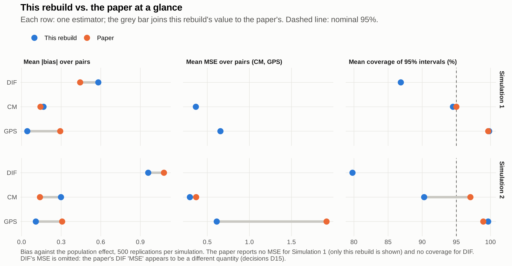
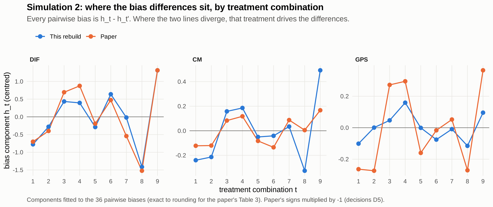

# Guo, Liu & Wang (2022) simulations: replication verdict

The two simulation studies (Section 5) were rebuilt in R from the published text
alone, with 500 replications each, as in the paper. "Ours" is this rebuild under
the choices in [`decisions.md`](decisions.md). Bias is $E(\hat\tau)-\tau$ against
the population effect, with the paper's signed values multiplied by −1 (D5).
Monte Carlo SEs: bias at most 0.06; coverage near 95% about 1 point.

## Verdict

The paper's qualitative claims about bias reduction and efficiency are
reproduced. Its explanation for GPS's lower efficiency is not supported. One
pattern in its tables is reversed: which matching estimator is less biased. Two
columns of its Table 3 appear to follow different conventions from its own
definitions: the DIF "MSE" and the sign of the biases.



| # | Claim or reported result | Paper | This rebuild | Verdict |
|---|---|---|---|---|
| 1 | "Both the covariate matching method and the generalized propensity score matching method significantly reduce bias" (Sim 1, p. 974) | mean \|bias\| DIF 0.44, CM 0.14, GPS 0.29; DIF worse than CM in 5/6 pairs, than GPS in 4/6 | DIF 0.58, CM 0.17, GPS 0.04; 6/6 and 6/6 | **Reproduced** |
| 2 | The same for Sim 2 (p. 975) | DIF 1.08, CM 0.14, GPS 0.31; 34/36 and 33/36 | DIF 0.96, CM 0.30, GPS 0.11; 35/36 and 35/36 | **Reproduced** |
| 3 | "The estimator based on covariates matching is more efficient" (Sim 2, p. 975) | MSE CM < GPS in 36/36 pairs | 33/36 (Sim 1: 6/6) | **Reproduced** |
| 4 | "Coverage rates … from the covariate matching method are very close to the 95% nominal coverage rate" (Sim 1, p. 974) | 92–98% | 92.0–97.2% (mean 94.5%), interval method D26 | **Reproduced** |
| 5 | GPS coverage (Tables 1, 3) | 99–100% (Sim 1), 96–100% (Sim 2) | 99.6–100%, 98.6–100% | **Reproduced**, and explained below |
| 6 | Sim 2 DIF biases (Table 3) | 36 values | correlation 0.96 (30/36 signs agree), but only 8/36 within 2 SE | **Pattern reproduced**; some values differ (D20) |
| 7 | Which matching estimator is less biased (Tables 1, 3) | CM less biased in 6/6 and 32/36 pairs | CM less biased in 0/6 and 6/36 | **Not reproduced** (reversed) |
| 8 | CM coverage in Sim 2 (Table 3) | 92–100% | 63–98% (mean 90.3%) | **Not reproduced**; follows from #7 |
| 9 | GPS is less efficient "due to the misspecification of the propensity score modeling" (p. 978) | stated as a possible reason | correctly specified model: MSE ×1.08 (Sim 1), ×1.37 (Sim 2); true scores: ×2.4–2.7 | **Not supported** |
| 10 | DIF "MSE" (Table 3) | 49–335 | 0.5–9.2; the paper's values are 0.81–1.00 × Var(Y\|t) + Var(Y\|t′) | **Different quantity** (D15) |
| 11 | Sign of the bias (Table 3) | as printed | the printed signs match ours only after a sign flip (correlation −0.96 → +0.96) | **Convention reversed** relative to eq. (1) (D5) |

## Evidence

**Data-generating process.** The paper leaves five points of the DGP open. They
were settled by comparing population quantities with the paper's own DIF column,
the one estimator with no modelling choices (D1–D5): $Z_1 \sim$ U(−3, 3), equal
group sizes drawn from the assignment model, and the population effect as the
truth. The simulated DIF bias then agrees with its population value (|z| ≤ 2.4),
so the DGP is implemented as specified. The remaining gaps in the paper's DIF
column (#6) are not explained by any reading tried.

**Internal consistency of the paper's tables.** Each estimator has the form
$\hat m_t - \hat m_{t'}$, so each bias column must decompose as $h_t - h_{t'}$.
All three of the paper's bias columns do, to rounding (max residual 7e-5). This
confirms the transcription and that the paper's estimators average imputed
outcomes over all units.

**Where the differences sit.** Every pairwise bias is $h_t - h_{t'}$, so the 36
biases of each estimator reduce to nine per-treatment components. In Simulation 2
the DIF gaps are concentrated in combinations 3, 4 and 7, and the CM gaps in 8
and 9. The paper's GPS components are larger than ours for most combinations.



**Which estimator is less biased (#7).** The paper's GPS bias is about 2.3× ours
(correlation 0.83). Its CM bias is about a third of ours (correlation 0.73). The
CM distance metric does not explain this: with one Mahalanobis distance over all
covariates, or Mahalanobis on X plus Euclidean on Z, Sim 2 mean |bias| is
0.27–0.30 against the paper's 0.14 (`results/cm_metric_sensitivity/`). The cause
lies in implementation details the paper does not give.

**Propensity-score specification (#9).** Matching on a correctly specified
multinomial logit gives about the same bias and a larger MSE. Matching on the
true scores is worse still. Under equal group sizes, the probability of
treatment $t$ within the sample is proportional to $p_t(x)/\pi_t$. That is not a
function of the population score $p_t(x)$ alone, so the population score does
not balance the sample. A model fitted to the sample estimates the right score,
and the correctly specified logit is exactly right for it, because only the
intercepts shift.

**GPS coverage (#5).** The analytic SE (D26) is calibrated when matching on the
true scores: estimated SE / Monte Carlo SD = 0.98–1.00, coverage 94%. With
estimated scores the estimator varies much less (SD 0.76–0.79 vs 1.23–1.25), and
an SE that ignores score estimation is about 1.5× too large. That gives coverage
of 99.6–100%, matching the paper's near-100% values. The paper does not say how
its intervals were built.

**CM coverage in Sim 2 (#8).** Per-pair coverage correlates −0.92 with
|bias|/SD. Even an oracle interval built from the true SD covers only 85.6% on
average. The under-coverage comes from CM's bias, not its SE (SE ratio 1.14).

## Implications

* For applied use, the direction of the paper's conclusions holds: both
  matching estimators remove most of the confounding bias in the sample
  difference, and covariates matching has the smaller MSE.
* Which matching estimator has less bias depends on implementation details the
  paper does not report. The paper's ranking should not be relied on without the
  original code.
* When groups are sampled to equal sizes, estimate the propensity score in the
  sample. Do not plug in population scores.
* Intervals for GPS matching that ignore propensity-score estimation are
  conservative here, so near-100% coverage is expected rather than a sign of
  good calibration.
* Readers of Table 3 can read its DIF MSE column as within-group variances,
  and its bias signs as $E(\hat\tau(t',t)) - \tau(t',t)$.

## Reproduce

From the repository root, with R 4.3.3 (about 15 minutes on 4 cores in total):

```sh
Rscript scripts/run_tests.R
Rscript scripts/compute_truth.R
Rscript scripts/run_simulations.R sim1,sim2 1 500 results/runs 4
Rscript scripts/stage3_analysis.R
Rscript scripts/run_extra.R cm_metrics sim1,sim2 1 500 results/runs_cm_metrics 4
Rscript scripts/cm_metric_analysis.R
Rscript scripts/run_extra.R stage4 sim1,sim2 1 500 results/runs_stage4 4
Rscript scripts/stage4_analysis.R
Rscript scripts/comparison_figures.R
```
